

# Hi, I'm Kofi Annang · 7Kbytes

**Full-stack and mobile developer in Ghana. I design, build and ship complete products for real businesses: web platforms, Flutter apps, APIs and the operations tools behind them.**

[Portfolio](https://portfolio-eta-ivory-yshi67xev0.vercel.app) · [Email](mailto:7kbytesgh@gmail.com) · [Case studies](#case-studies) · [More live work](#more-live-work) · [Tech stack](#tech-stack)

---

### At a glance

- **8 case studies** across logistics, car rental, marketplaces, property, sports, education and health, plus more products live on the web.
- **Sole developer on most of them:** product design, UI, front end, mobile, backend, database, auth, payments, deployment and CI.
- **Built for Ghana and the Gulf:** Mobile Money and Paystack payments, WhatsApp-first contact, dual-currency pricing, and pages that load fast on low-end phones and slow data.
- **The source code for client work is private.** Each case study below is a public showcase with screenshots, a demo video, an architecture diagram and the engineering decisions behind it.

## Case studies

<table>
<tr>
<td width="50%" valign="top">
<a href="https://github.com/7kbytes/primecargo-showcase">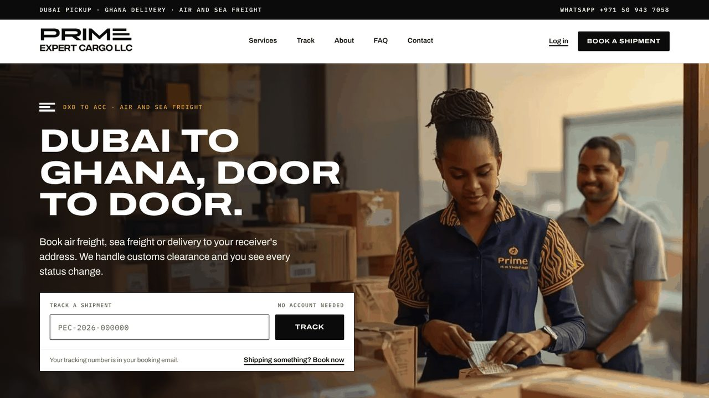</a>
<h3>Prime Expert Cargo</h3>

Logistics platform for a Dubai to Ghana freight forwarder: online booking, quotes, a nine-stage shipment tracker and public tracking. Four apps sharing one API.

Flutter · Next.js · React · Node.js · PostgreSQL · Firebase Auth

<b><a href="https://github.com/7kbytes/primecargo-showcase">Case study</a> · <a href="https://primeexpertcargollc.com">Live site</a></b>

</td>
<td width="50%" valign="top">
<a href="https://github.com/7kbytes/prime-rental-showcase">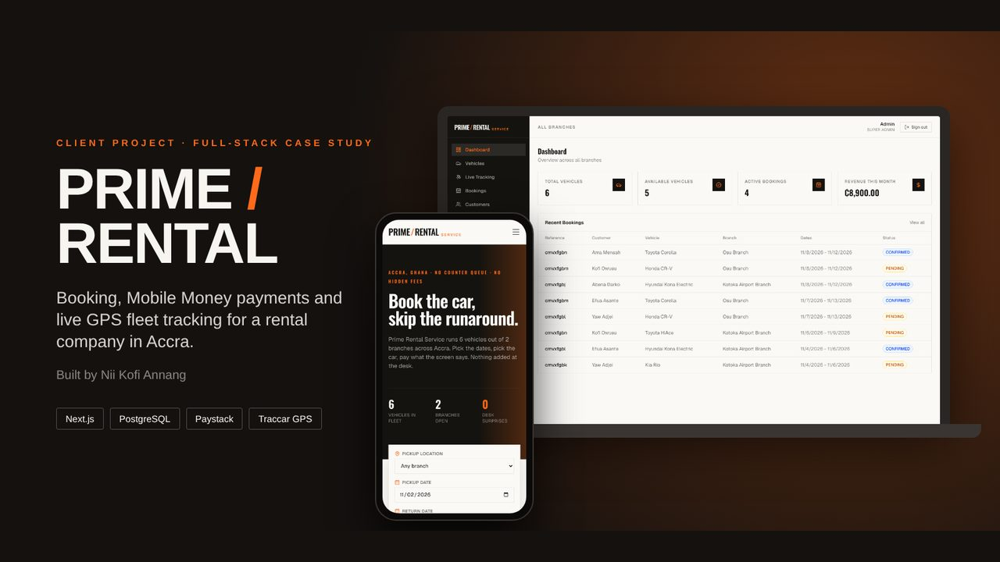</a>
<h3>Prime Rental</h3>

Car rental platform for a two-branch company in Accra: availability without double bookings, card and Mobile Money payments, and live GPS tracking with a guarded remote engine cut-off.

Next.js 16 · PostgreSQL · Prisma · Paystack · Traccar GPS

<b><a href="https://github.com/7kbytes/prime-rental-showcase">Case study</a></b>

</td>
</tr>
<tr>
<td width="50%" valign="top">
<a href="https://github.com/7kbytes/primahk-showcase">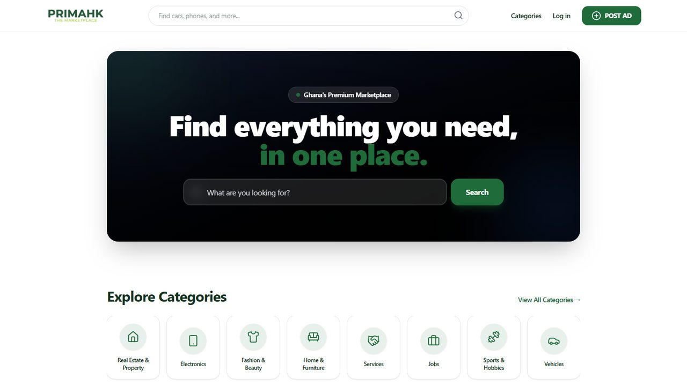</a>
<h3>Primahk</h3>

Classifieds marketplace for Ghana: structured listings, typo-tolerant and location-based search, real-time chat, moderation and paid featured placement.

Next.js · React Native · NestJS · PostgreSQL + PostGIS · Meilisearch · Socket.IO

<b><a href="https://github.com/7kbytes/primahk-showcase">Case study</a> · <a href="https://primahk.store">Live site</a></b>

</td>
<td width="50%" valign="top">
<a href="https://github.com/7kbytes/dkiproperties-showcase">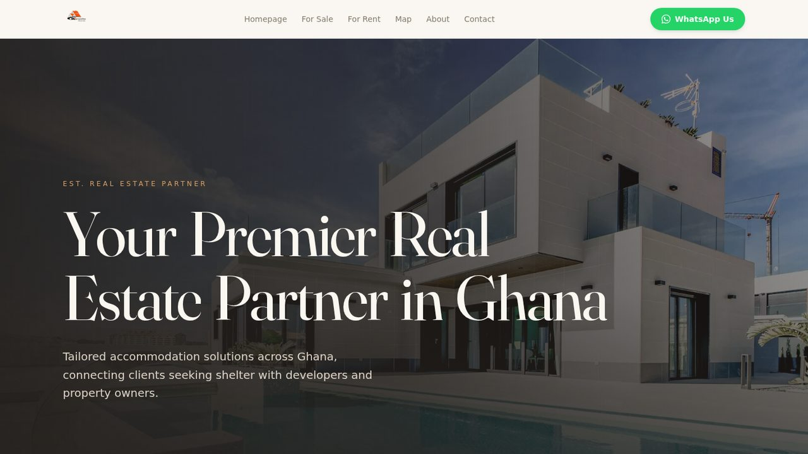</a>
<h3>DKI Properties</h3>

Property platform for a real estate agency: a cleaned and de-duplicated catalog synced from its marketplace shop, map browsing, GH₵ and USD pricing and one-tap WhatsApp.

Next.js 16 · Firestore · Cloudinary · Resend · Netlify

<b><a href="https://github.com/7kbytes/dkiproperties-showcase">Case study</a> · <a href="https://dkiproperties.netlify.app">Live site</a></b>

</td>
</tr>
<tr>
<td width="50%" valign="top">
<a href="https://github.com/7kbytes/sccsmallpolesleague-showcase">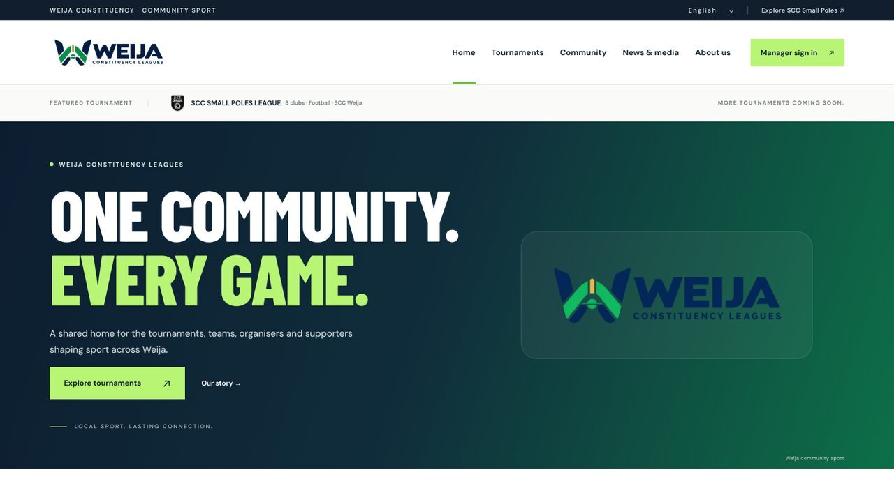</a>
<h3>SCC Small Poles League</h3>

Grassroots football platform for Weija: public league pages, a manager portal for squads, and organiser tools for reviews, fixture draws, scores and an audit log.

JavaScript · Node.js serverless · Supabase Auth + Postgres · Vercel

<b><a href="https://github.com/7kbytes/sccsmallpolesleague-showcase">Case study</a> · <a href="https://sccsmallpolesleague.vercel.app">Live site</a></b>

</td>
<td width="50%" valign="top">
<a href="https://github.com/7kbytes/gomer-showcase">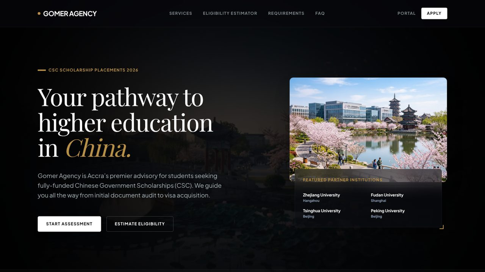</a>
<h3>Gomer Agency</h3>

Admissions portal for Chinese Government Scholarships: an eligibility estimator, a student document hub and progress tracker, and a Kanban pipeline for advisors.

Next.js 16 · Firebase Auth · Firestore · Cloud Storage · Firebase Hosting

<b><a href="https://github.com/7kbytes/gomer-showcase">Case study</a> · <a href="https://gomer-agency-admissions.web.app">Live site</a></b>

</td>
</tr>
<tr>
<td width="50%" valign="top">
<a href="https://github.com/7kbytes/maestrosports-showcase">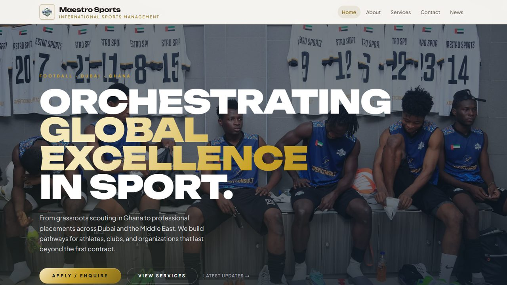</a>
<h3>Maestro Sports</h3>

Production website for a football management company working between Ghana and Dubai, with optimised match photography and a dependable enquiry pipeline.

Next.js 15 · Tailwind CSS 4 · Framer Motion · GSAP · Resend · Vercel

<b><a href="https://github.com/7kbytes/maestrosports-showcase">Case study</a> · <a href="https://maestrosportsmanagement.com">Live site</a></b>

</td>
<td width="50%" valign="top">
<a href="https://github.com/7kbytes/medlink-showcase">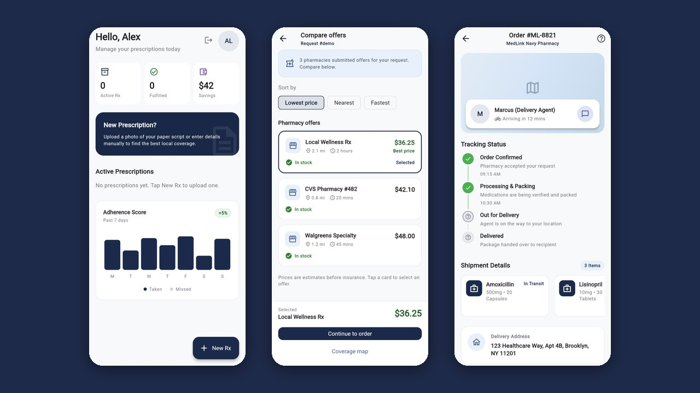</a>
<h3>MedLink</h3>

Prescription marketplace app: patients upload a script, pharmacies send quotes, and patients compare coverage and track the order. Patient, pharmacy and admin roles in one app.

Flutter · Supabase Auth, Postgres + RLS, Storage · TOTP MFA

<b><a href="https://github.com/7kbytes/medlink-showcase">Case study</a></b> · Prototype

</td>
</tr>
</table>

## More live work

<table>
<tr>
<td width="33%" valign="top">
<a href="https://bkm-travel.vercel.app">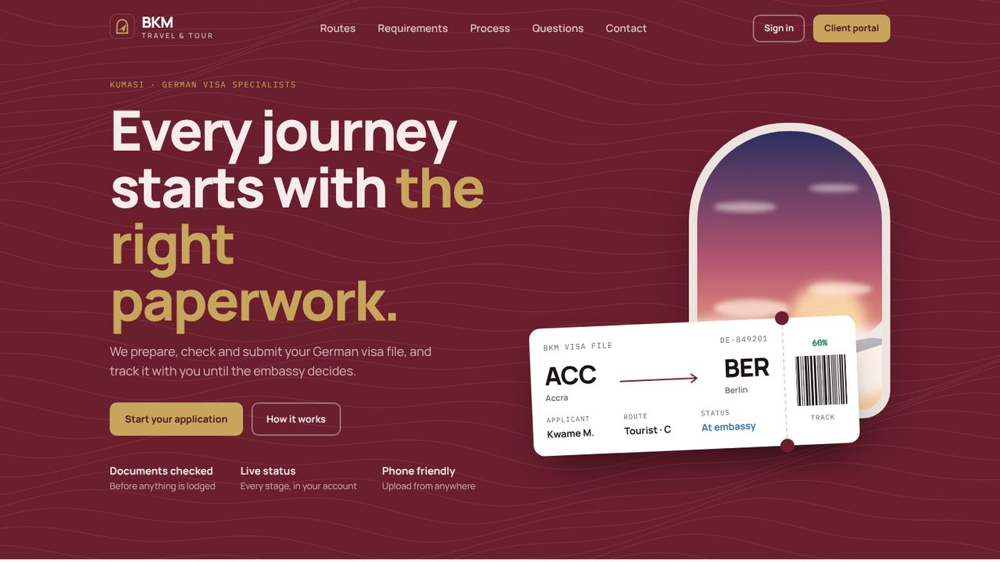</a>

<b><a href="https://bkm-travel.vercel.app">BKM Travel & Tour</a></b> 
German visa specialists in Kumasi: prepare, check and track a visa file online.

React · Firebase

</td>
<td width="33%" valign="top">
<a href="https://primelords-esports.vercel.app">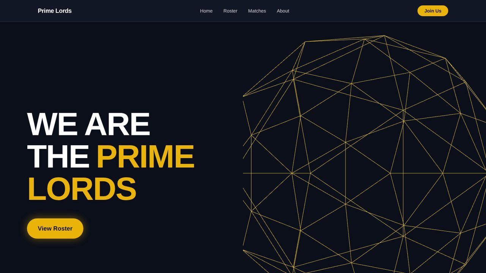</a>

<b><a href="https://primelords-esports.vercel.app">Prime Lords Esports</a></b> 
Brand site for an esports team, with roster and match pages and 3D visuals.

Next.js · React · Three.js

</td>
<td width="33%" valign="top">
<a href="https://local-job-connector-gh.web.app">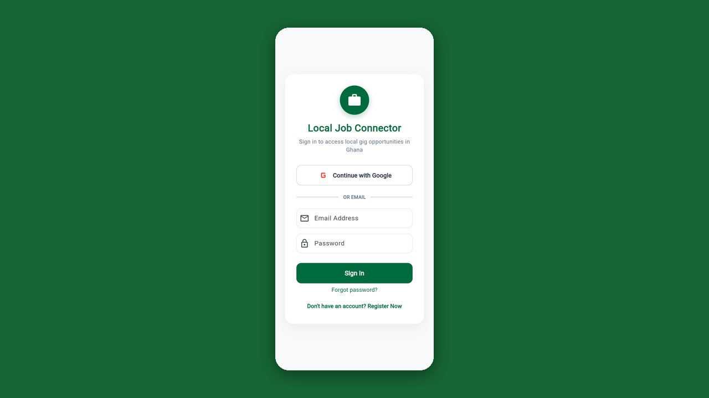</a>

<b><a href="https://local-job-connector-gh.web.app">Local Job Connector</a></b> 
A marketplace for short-term local gigs in Ghana.

Flutter · Firebase

</td>
</tr>
</table>

## How I build

- **Business rules live on the server.** Prices, statuses, approvals and permissions are decided by the API or by database security rules, never by the browser.
- **Payments that survive failure.** Signed webhooks, server-side verification and idempotent confirmation, so a payment is recorded once even if the redirect fails.
- **Mobile first, for real networks.** Pages are checked at phone width and kept light for low-end phones and slow data.
- **Fit for the market.** Mobile Money, WhatsApp-first contact and dual-currency prices where customers expect them.
- **Shipped with checks.** Unit, widget and browser tests, with lint and builds in GitHub Actions on every push.
- **Honest showcases.** Screenshots use real apps with sample data, and I only publish numbers I can back up.

## Tech stack

**Frontend:** Next.js · React · TypeScript · JavaScript · Tailwind CSS · GSAP · Framer Motion · Three.js 
**Mobile:** Flutter · Dart · React Native · Expo 
**Backend:** Node.js · Express · NestJS · REST APIs · WebSockets (Socket.IO) 
**Data:** PostgreSQL · Prisma · PostGIS · Firestore · Supabase · Redis · Meilisearch 
**Auth and payments:** Firebase Auth · Supabase Auth · Auth.js · Paystack (cards and Mobile Money) 
**Delivery:** Vercel · Firebase Hosting · Netlify · Docker · Render · GitHub Actions · Playwright · Vitest

## Contact

Have a product in mind or want to see a walkthrough?

- **Email:** [7kbytesgh@gmail.com](mailto:7kbytesgh@gmail.com)
- **Portfolio:** [portfolio-eta-ivory-yshi67xev0.vercel.app](https://portfolio-eta-ivory-yshi67xev0.vercel.app)
